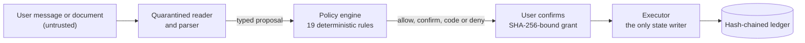

# Corridor AI

**The AI can only suggest. It can never pay.**

Corridor AI is a safety-constrained AI financial agent for international students, migrant workers and their families who move money across borders. It compares remittance routes, plans tuition payments across currencies and accounts, and builds a portable rent and credit history, in English, Nepali and Simplified Chinese.

Built for the 2026 Shenzhen International FinTech Competition, International Track, Topic C (Cross-border and Student Finance).

> **Sandbox only.** Every person, account, provider and transfer is synthetic. Nothing connects to a real bank or payment network, and nothing is on-chain.

## How it works

Language models are treated as compromised. They can read and propose, but they have no path to money.



- **Quarantined reader.** Uploaded documents only reach a reader with no tools. Its output is typed fields, labelled untrusted.
- **Deterministic policy.** A pure function of 19 rules decides every proposal. The strictest rule wins, and no model can override it.
- **What you see is what you sign.** A confirmation is a single-use grant bound to the SHA-256 hash of the exact proposal shown, valid for 120 seconds.
- **Bounded loss.** An account taken from a document cannot be paid for 24 hours, then only up to a small cap until a bank officer verifies it.
- **Tamper-evident ledger.** Every proposal, decision and execution is logged before it takes effect. Editing one entry breaks the chain at that entry.
- **Bank console.** Officers see the full trace of each decision, with the rule ids, and verify payees under their own id.

Everyday features that need no model at all: route comparison in exact integer arithmetic, a CP-SAT tuition funding plan, and an Ed25519-signed Credit Passport with selective disclosure.

Full design: [Technical Document](docs/submission/Corridor_AI_Technical_Document.pdf) and the security invariants INV-1 to INV-12 in [docs/spec/architecture.md](docs/spec/architecture.md).

## Run it (offline, no API key)

Requirements: macOS or Linux, Docker, [uv](https://docs.astral.sh/uv/), Node 22 and [pnpm](https://pnpm.io/). Details: [docs/DEPLOYMENT.md](docs/DEPLOYMENT.md).

```bash
make setup     # .env from .env.example, dependencies, Postgres, migrations
make demo      # reset the sandbox and start the API and apps with recorded model answers
```

| What | Where |
|---|---|
| Customer app | http://127.0.0.1:3000 |
| Bank console | http://127.0.0.1:3000/console |
| Credit Passport verifier | http://127.0.0.1:3000/verify |

Console officer tokens are generated on first start into `secrets/officer_tokens.json` (git-ignored). Start with [JUDGES.md](JUDGES.md) for what to try.

## Tests

| Command | What it checks | Result |
|---|---|---|
| `make test` | unit and integration | 1,384 passed |
| `make test-safety` | properties, concurrency, ledger tamper, red-team smoke | 466 passed |
| `make web-e2e` | browser tests in three languages | 42 passed |
| `make evidence` | six sandbox scenarios through the real API | 6 of 6 |

Details: [docs/TESTING.md](docs/TESTING.md). Sandbox logs: [Execution Evidence](docs/submission/Corridor_AI_Execution_Evidence.pdf).

## Limits

The [published evaluation](docs/evaluation.md) (report `20261011T175100`) is a single seed on an earlier build. A fully deceived user is bounded by limits, not stopped. There has been no external penetration test yet. Fees, FX rates and limits are illustrative. See the [Security Self-Assessment](docs/submission/Corridor_AI_Security_Self_Assessment.pdf).

## Team and licence

Yajan Adhikari (IOE-TU, Nepal) and Ujjawal Chapagai (DGIST, South Korea). MIT licence, see [LICENSE](LICENSE) and [THIRD_PARTY_LICENSES.md](THIRD_PARTY_LICENSES.md).
